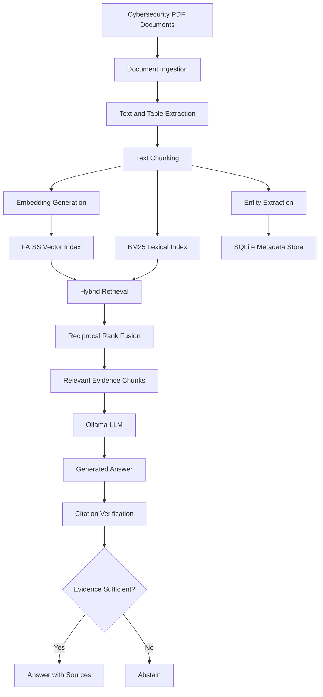

# SecuQuery – Cybersecurity Intelligence Assistant

**A Retrieval-Augmented Generation (RAG) system for searching, analyzing, and extracting actionable information from cybersecurity documents.**

SecuQuery is a cybersecurity document intelligence assistant that uses Hybrid Retrieval-Augmented Generation (RAG) to answer questions from cybersecurity PDFs. It combines semantic vector search, keyword-based retrieval, and Large Language Models (LLMs) to provide context-aware answers supported by source evidence.

The system is designed to reduce unsupported AI-generated responses through citation verification and evidence-based abstention. It also supports vulnerability information extraction and cross-document comparison.

---

## Table of Contents

- [Overview](#overview)
- [Key Features](#key-features)
- [System Architecture](#system-architecture)
- [Technology Stack](#technology-stack)
- [Project Structure](#project-structure)
- [Installation and Setup](#installation-and-setup)
- [Adding Documents](#adding-documents)
- [Running the Application](#running-the-application)
- [How the RAG Pipeline Works](#how-the-rag-pipeline-works)
- [Evaluation](#evaluation)
- [Limitations](#limitations)
- [Future Improvements](#future-improvements)

---

## Overview

Cybersecurity professionals frequently work with large collections of security advisories, vulnerability reports, technical documentation, and security frameworks. Finding relevant information across these documents manually can be time-consuming.

Traditional keyword searches may also fail to identify semantically relevant information, while general-purpose LLMs can generate responses that are not supported by the available documentation.

**SecuQuery addresses these challenges through a document-grounded RAG architecture.**

Users can upload cybersecurity PDFs and ask natural-language questions about vulnerabilities, security recommendations, mitigation strategies, and technical concepts.

Rather than relying exclusively on the LLM's internal knowledge, SecuQuery retrieves relevant evidence from the document collection and uses that evidence to generate responses with source references.

## Key Features

### 1. PDF Document Ingestion
- Upload and process cybersecurity PDF documents.
- Extract page-level text using PyMuPDF.
- Extract tabular information using pdfplumber.
- Preserve document names and page numbers for traceability.
- Divide extracted content into overlapping chunks for retrieval.

### 2. Hybrid Information Retrieval
- **Semantic Search:** FAISS vector similarity search retrieves conceptually relevant information.
- **Keyword Search:** BM25 retrieves documents based on exact terms, identifiers, and technical keywords.
- **Reciprocal Rank Fusion (RRF):** Combines both retrieval results into a unified ranking.
- **Exact Identifier Matching:** Improves retrieval for vulnerability identifiers such as CVEs and CWEs.

### 3. Evidence-Grounded Question Answering
- Uses an Ollama-hosted LLM to generate answers from retrieved document context.
- Provides source references and supporting quotations.
- Restricts responses to information available in the retrieved evidence.
- Abstains when sufficient supporting information cannot be found.

### 4. Citation Verification
- Checks whether generated quotations exist in their corresponding retrieved chunks.
- Reduces unsupported citations and fabricated quotations.
- Provides an additional verification layer before presenting responses.

### 5. Vulnerability Information Extraction
Extracts structured cybersecurity information, including:
- CVE identifiers
- CWE identifiers
- CVSS scores
- MITRE ATT&CK technique references
- Affected versions and security-related details where available

### 6. Cross-Document Comparison
- Compares information across multiple cybersecurity documents.
- Identifies differences, missing information, and potential conflicts.
- Helps users understand how different documents describe vulnerabilities and mitigation strategies.

### 7. Evidence-Based Abstention
When the document collection does not contain sufficient evidence to answer a question, SecuQuery can decline to provide an unsupported answer instead of generating speculative information.

---

## System Architecture



### Architecture Components

| Component | Responsibility |
|---|---|
| Ingestion | Reads PDF documents and extracts page-level content |
| Table Extraction | Extracts structured information from PDF tables |
| Chunking | Splits content into overlapping, page-aware chunks |
| Entity Extraction | Identifies CVEs, CWEs, CVSS scores, and other entities |
| Embeddings | Converts text chunks into numerical vector representations |
| FAISS | Performs semantic similarity search |
| BM25 | Performs keyword-based document retrieval |
| RRF | Combines semantic and lexical retrieval rankings |
| SQLite | Stores document, chunk, entity, and extraction metadata |
| Ollama | Runs the local LLM for response generation |
| Verification | Validates generated quotations against retrieved evidence |
| Streamlit | Provides the interactive user interface |

---

## Technology Stack

| Category | Technologies |
|---|---|
| Programming Language | Python |
| Frontend | Streamlit |
| PDF Processing | PyMuPDF, pdfplumber |
| Embeddings | Sentence Transformers |
| Vector Database / Index | FAISS |
| Lexical Retrieval | BM25 |
| Ranking | Reciprocal Rank Fusion (RRF) |
| LLM Runtime | Ollama |
| Database | SQLite |
| Testing | pytest |
| Data Processing | NumPy |

---

## Project Structure

```text
secquery/
│
├── README.md
├── pyproject.toml
├── requirements.txt
├── .env.example
├── .gitignore
│
├── .github/
│   └── workflows/
│       └── ci.yml
│
├── data/
│   ├── sources.csv
│   ├── pdfs/
│   ├── synthetic/
│   └── index/
│
├── src/
│   └── secquery/
│       ├── config.py
│       ├── models.py
│       ├── ingest.py
│       ├── tables.py
│       ├── chunking.py
│       ├── entities.py
│       ├── embeddings.py
│       ├── store.py
│       ├── index.py
│       ├── lexical.py
│       ├── hybrid.py
│       ├── build.py
│       ├── prompts.py
│       ├── llm.py
│       ├── verify.py
│       ├── extract.py
│       ├── compare.py
│       ├── baseline.py
│       ├── pipeline.py
│       └── controls.py
│
├── app/
│   ├── streamlit_app.py
│   └── tabs/
│       ├── __init__.py
│       ├── library.py
│       ├── ask.py
│       ├── extract.py
│       └── compare.py
│
├── scripts/
│   ├── check_pdfs.py
│   ├── build_index.py
│   ├── tune_threshold.py
│   ├── make_synthetic.py
│   ├── evaluate.py
│   └── analyze_results.py
│
├── eval/
│   ├── dev_questions.json
│   ├── questions.json
│   ├── gold_fields.csv
│   ├── comparison_pairs.json
│   ├── seeded_conflicts.json
│   ├── injection_cases.json
│   ├── rubric.md
│   └── results/
│
└── tests/
    ├── conftest.py
    ├── test_config.py
    ├── test_ingest.py
    ├── test_tables.py
    ├── test_chunking.py
    ├── test_entities.py
    ├── test_store.py
    ├── test_index.py
    ├── test_lexical.py
    ├── test_hybrid.py
    ├── test_verify.py
    ├── test_extract.py
    ├── test_compare.py
    └── test_pipeline_abstain.py
```

---

## Installation and Setup

### Prerequisites

Make sure the following are installed:

- Python version supported by `pyproject.toml`
- Git
- Ollama
- A compatible Ollama language model

### 1. Clone the Repository

```bash
git clone https://github.com/YOUR_USERNAME/secquery.git
cd secquery
```

### 2. Create a Virtual Environment

**Windows (PowerShell):**

```powershell
python -m venv .venv
.venv\Scripts\Activate.ps1
```

**Linux / macOS:**

```bash
python -m venv .venv
source .venv/bin/activate
```

### 3. Install Dependencies

```bash
pip install --upgrade pip
pip install -r requirements.txt
```

For development and tests, install the project in editable mode if supported by the repository configuration:

```bash
pip install -e .
```

### 4. Configure Environment Variables

Create a local `.env` file using the example configuration:

```bash
cp .env.example .env
```

On Windows PowerShell:

```powershell
Copy-Item .env.example .env
```

Update the configuration with the appropriate Ollama URL, model name, timeout, storage paths, and retrieval settings. Use the variable names defined in `.env.example`.

### 5. Set Up Ollama

Install Ollama from:

https://ollama.com/

Pull a compatible model. For example:

```bash
ollama pull llama3.1:8b
```

Run the model:

```bash
ollama run llama3.1:8b
```

Ensure the Ollama service is accessible at:

```text
http://localhost:11434
```

The model configured in `.env` must match the model available in your local Ollama installation.

---

## Adding Documents

Place your cybersecurity PDF files inside:

```text
data/pdfs/
```

The initial corpus can contain a small collection of cybersecurity resources, such as:

- NIST Cybersecurity Framework 2.0
- OWASP Top 10 documentation
- CISA Known Exploited Vulnerabilities advisories
- Cybersecurity vulnerability and mitigation reports

Additional documents can be included to expand the knowledge base.

Keep track of document source information and ensure that you have permission to use and distribute the files.

Run the PDF validation script:

```bash
python scripts/check_pdfs.py
```

Then build the retrieval index:

```bash
python scripts/build_index.py
```

The index and associated metadata are stored locally according to the project configuration.

---

## Running the Application

Launch the Streamlit application:

```bash
streamlit run app/streamlit_app.py
```

The application provides four primary interfaces:

| Tab | Functionality |
|---|---|
| Library | Manage and inspect uploaded cybersecurity documents |
| Ask | Ask questions and receive evidence-grounded responses |
| Extract | Extract structured vulnerability information |
| Compare | Compare information across multiple documents |

---

## How the RAG Pipeline Works

### Step 1: Document Ingestion

PDF documents are processed using PyMuPDF. Text is extracted page by page, while pdfplumber handles tables where possible.

Document metadata, page numbers, and extracted content are preserved for traceability.

### Step 2: Chunking

The extracted text is divided into smaller overlapping chunks.

Overlapping chunks help preserve contextual information across chunk boundaries. Page boundaries are maintained so that retrieved information can be traced to its original source.

### Step 3: Embedding Generation

Sentence Transformers converts each chunk into a numerical vector representation.

These embeddings capture semantic relationships between text passages and allow the system to retrieve conceptually relevant content.

### Step 4: Hybrid Retrieval

When a user submits a question, two retrieval methods run:

- FAISS retrieves semantically similar chunks.
- BM25 retrieves chunks using lexical and keyword relevance.

The results are combined using Reciprocal Rank Fusion (RRF), producing a unified ranking of relevant evidence.

### Step 5: LLM-Based Answer Generation

The selected evidence chunks are passed to the Ollama-hosted LLM alongside a structured prompt.

The model generates an answer grounded in the retrieved document context.

### Step 6: Citation Verification

Generated quotations are checked against the original retrieved chunks.

The system uses this verification step to detect quotations that cannot be found in the cited evidence.

### Step 7: Evidence-Based Abstention

When the system cannot retrieve sufficient evidence to support an answer, it can abstain rather than produce an unsupported response.

---

## Evaluation

SecuQuery includes an evaluation framework designed to measure retrieval quality, extraction performance, citation reliability, and response latency.

The evaluation dataset can include questions covering:

- Direct factual information
- CVE and CWE identification
- Vulnerability mitigation strategies
- Cross-document comparisons
- Unanswerable questions
- Conflicting document evidence
- Prompt injection test cases

### Evaluation Metrics

| Metric | Purpose |
|---|---|
| Recall@5 | Measures whether relevant evidence appears within the top five retrieved chunks |
| Citation Text-Match Rate | Measures whether generated quotations exist in the cited source chunks |
| Semantic Citation Support | Measures whether cited evidence actually supports the generated claim |
| Correct Abstention Rate | Measures the system's ability to refuse unanswerable questions |
| Extraction Precision, Recall and F1 | Evaluates structured vulnerability information extraction |
| P95 Response Latency | Measures response time at the 95th percentile |

### Retrieval Comparison

The evaluation framework can compare three configurations:

1. Vector-only retrieval using FAISS.
2. Hybrid retrieval using FAISS and BM25 with RRF.
3. Hybrid retrieval combined with citation verification and abstention.

This comparison helps assess whether hybrid retrieval and verification improve system reliability over a vector-only baseline.

**Note:** Performance figures should be reported only after running the evaluation scripts against a manually labelled test dataset. Results will depend on document quality, query coverage, model selection, and hardware.

---

## Limitations

- The system's knowledge is limited to the documents included in its local corpus.
- Scanned PDFs may require OCR before their content can be indexed.
- Citation text matching confirms that a quotation exists but does not guarantee that the quotation logically supports the generated claim.
- LLM responses may still contain inaccuracies.
- Extraction quality depends on document formatting and the structure of the source information.
- The system is a document intelligence prototype, not an automated vulnerability scanner or production security monitoring platform.

**Important:** SecuQuery should be treated as an analyst-assistance tool. Security decisions and mitigation actions should be independently validated against authoritative sources.

---

## Future Improvements

- Integrate LangGraph for stateful, multi-step cybersecurity investigation workflows.
- Add live enrichment using NVD and CISA vulnerability feeds.
- Introduce OCR support for scanned cybersecurity documents.
- Improve citation verification with claim-level semantic evidence validation.
- Add role-based access control and document-level permissions.
- Support additional document formats such as DOCX and HTML.
- Introduce reranking models to improve retrieval relevance.
- Expand the evaluation corpus and benchmark against additional RAG configurations.
- Deploy the application using Docker and a cloud-hosted backend.

---

## Contributing

Contributions, suggestions, and improvements are welcome.

1. Fork the repository.
2. Create a feature branch.
3. Implement your changes.
4. Add or update tests.
5. Submit a pull request.

---

## License

This project is intended for academic and research purposes. Add an appropriate open-source license before distributing the repository.

---

**SecuQuery – Making cybersecurity documentation easier to search, understand, and analyze.**
